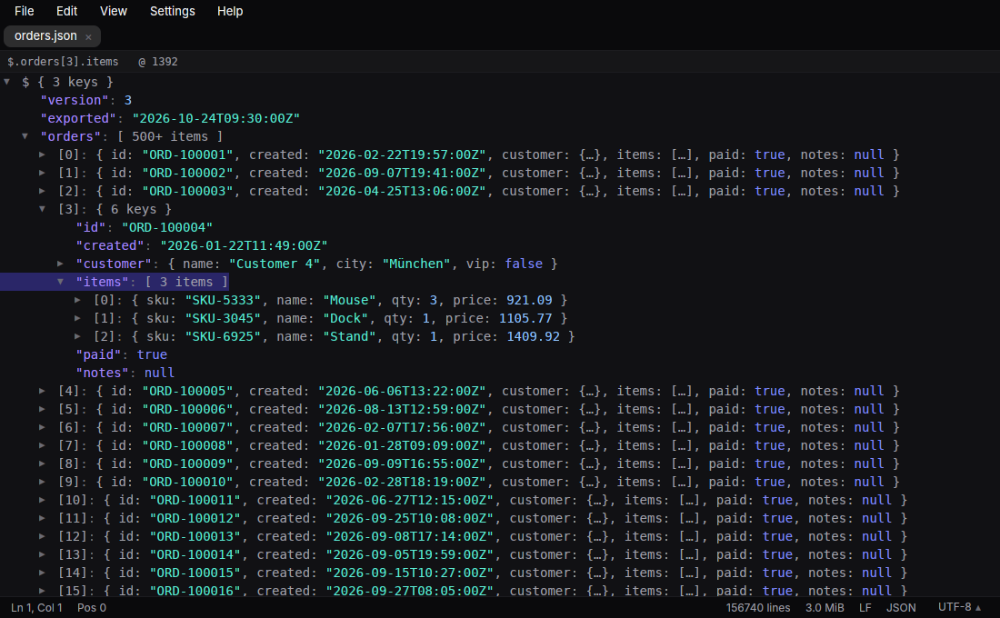
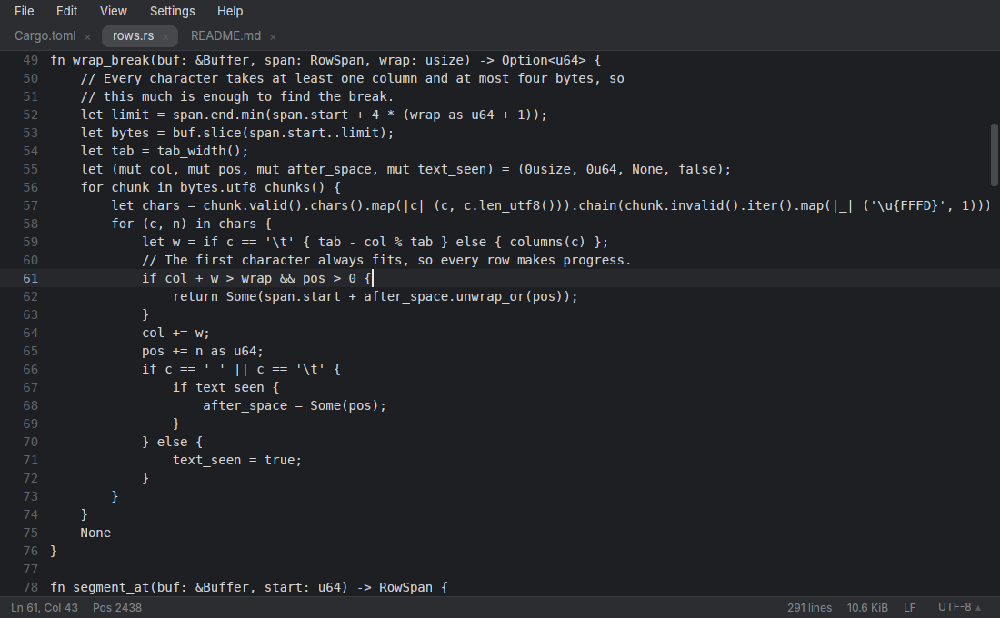
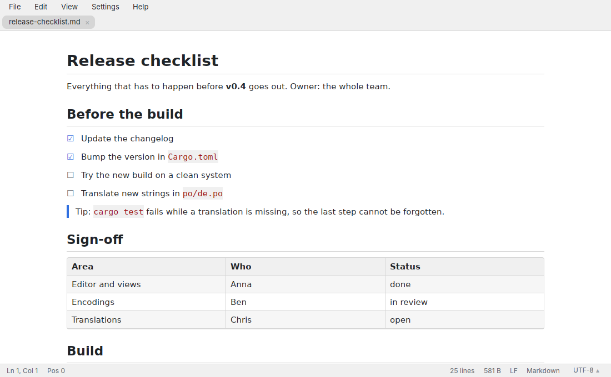

<div align="center">


# rustpad++

**A fast text editor for Linux, in the spirit of [Notepad++](https://notepad-plus-plus.org/) by Don Ho.**

**Opens files of any size instantly: as text, hex, JSON tree, Markdown or table.**

*Less editor. More text.*

### Install on Debian, Ubuntu or Linux Mint

```sh
wget https://github.com/srcmkr/rustpad-plusplus/releases/latest/download/rustpad_amd64.deb
sudo apt install ./rustpad_amd64.deb
```

Other distributions: download the
**[AppImage](https://github.com/srcmkr/rustpad-plusplus/releases/latest/download/Rustpad-x86_64.AppImage)**,
make it executable and start it.

[](https://github.com/srcmkr/rustpad-plusplus/releases/latest)
[](https://github.com/srcmkr/rustpad-plusplus/actions/workflows/build.yml)
[](#license)



</div>

## What it does

- **Any file opens right away**, whatever its size: files are memory-mapped,
  not loaded. A 1 TiB file is open at once, a 1.7 GiB log with 25 million lines
  is usable while its lines are counted in the background, and the first frame
  is on screen in under 300 ms.
- **Five views of the same file**: text, hex, a JSON tree that reads huge
  documents lazily, rendered Markdown and a sortable table for CSV.
  <kbd>Ctrl</kbd>+<kbd>1</kbd> to <kbd>5</kbd> switch, <kbd>Ctrl</kbd>+<kbd>E</kbd> cycles.
- **Editing without surprises**: find and replace (replace all is a single undo
  step), go to a line, a byte offset or a percentage, word wrap, duplicate and
  delete lines.
- **Never lose work**: on quit, all tabs come back including unsaved changes,
  without asking. Changes are backed up every second, so even after a crash
  only the last moments are missing; for large files only the changes are
  stored.
- **Keeps an eye on your files**: a growing log can be followed like
  `tail -f`; files changed, replaced, truncated or deleted by other programs
  are noticed and you decide what happens.
- **Encodings**: UTF-8 with or without BOM, UTF-16, Windows-1252,
  ISO-8859-1 and -15 are detected; reopen a file in another encoding or convert
  it from the status bar.
- **One window**: opening more files from the file manager or the command line
  adds tabs to the running window within milliseconds.

<table>
  <tr>
    <td></td>
    <td></td>
  </tr>
</table>

## Install

Every [release](https://github.com/srcmkr/rustpad-plusplus/releases/latest) has three files:

| For | File | Then |
|---|---|---|
| Debian, Ubuntu, Linux Mint | `rustpad_<version>_amd64.deb` | `sudo apt install ./rustpad_*_amd64.deb` |
| Any other distribution | `Rustpad-<version>-x86_64.AppImage` | `chmod +x Rustpad-*.AppImage && ./Rustpad-*.AppImage` |
| By hand | `rustpad-<version>-x86_64-linux.tar.gz` | Unpack, start `./rustpad`, then *Help → Check for Updates → Install for all users* |

New versions are offered in the app and installed on request; every file of a
release is signed, and only a correctly signed one is installed. The
AppImage and a copy run from its folder add themselves to the application
menu. Under *Settings → File Types* rustpad++ can become the default
application for text, log, Markdown, JSON and other files.

rustpad++ is developed on X11 (Cinnamon); Wayland is not well tested yet.

## Using it

```sh
rustpad notes.md server.log      # open files (as tabs of the running window)
rustpad -n                       # a separate window that leaves the session alone
```

| Keys | Does |
|---|---|
| <kbd>Ctrl</kbd>+<kbd>F</kbd>, <kbd>F3</kbd>, <kbd>Shift</kbd>+<kbd>F3</kbd> | find, next, previous |
| <kbd>Ctrl</kbd>+<kbd>H</kbd> | find and replace; <kbd>Tab</kbd> switches fields, <kbd>Enter</kbd> replaces and goes on |
| <kbd>Ctrl</kbd>+<kbd>G</kbd> | go to `1250` (line), `0x1F400` (byte offset) or `75%` |
| <kbd>Ctrl</kbd>+<kbd>1</kbd> … <kbd>5</kbd> | text, hex, JSON tree, Markdown, table |
| <kbd>Ctrl</kbd>+<kbd>D</kbd>, <kbd>Ctrl</kbd>+<kbd>Shift</kbd>+<kbd>L</kbd> | duplicate line, delete line |
| <kbd>Ctrl</kbd>+<kbd>+</kbd>, <kbd>Ctrl</kbd>+<kbd>-</kbd>, <kbd>Ctrl</kbd>+<kbd>0</kbd> | zoom |
| <kbd>Ctrl</kbd>+<kbd>,</kbd> | settings |

Word wrap and following the end of a file are in the *View* menu; the
encoding is changed by clicking it in the status bar. Settings live in
`~/.config/rustpad/settings.conf`, the session in `~/.local/state/rustpad`.

rustpad++ speaks English and German and follows the system language; it can
also be set under *Settings → General*. Color schemes: Dark, Light, Monokai and
Solarized Dark.

## How this project is built

This project is written with AI, and I say so openly. It started as a problem
I had myself; most of its code is produced by AI coding agents that I direct,
drawing on 35 years of building software.

This is **augmented coding**, not vibe coding.
[Vibe coding](https://en.wikipedia.org/wiki/Vibe_coding), as Andrej Karpathy
coined the term, means accepting whatever the model writes without looking at
the code. [Augmented coding](https://tidyfirst.substack.com/p/augmented-coding-beyond-the-vibes),
as Kent Beck describes it, means directing the AI towards tested, maintainable
code and owning the result. The difference is not who types; it is who
decides and how the result is checked.

- **I decide.** Scope, architecture and trade-offs are mine: I make them or
  sign them off. The AI proposes and implements; it does not get the last
  word.
- **Tests define "works".** Automated tests run on every push to the main
  branch and on every pull request. New features are tried in the real
  application before they are released, and the bugs found that way are
  fixed.
- **Nothing is hidden.** The code, the tests and the history are all here,
  for anyone to read and judge.

It is 2026. Writing every line by hand is no longer what makes software good;
taking responsibility for every decision is.

## Contributing

Bug reports, ideas, translations and pull requests are welcome. See
[CONTRIBUTING.md](CONTRIBUTING.md) for building from source, the layout of the
code and how releases are made.

## Credits

rustpad++ exists because of **[Notepad++](https://notepad-plus-plus.org/)** by
**Don Ho**, more than twenty years of a great example. It is an independent
project, not affiliated with or endorsed by the Notepad++ project. Built with
[GPUI](https://www.gpui.rs/), the UI framework of the [Zed](https://zed.dev/)
editor.

## License

Licensed under either of [Apache License, Version 2.0](LICENSE-APACHE) or
[MIT license](LICENSE-MIT) at your option. Unless you explicitly state
otherwise, any contribution intentionally submitted for inclusion in the work
by you, as defined in the Apache-2.0 license, shall be dual licensed as above,
without any additional terms or conditions.
